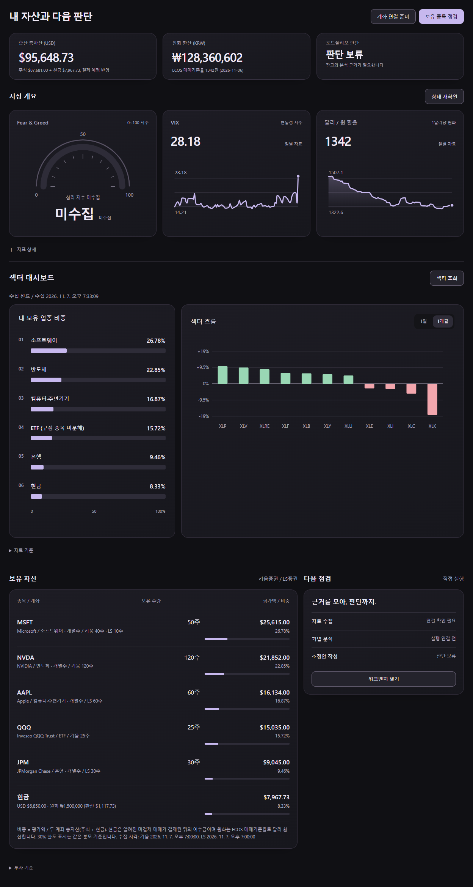

# Market Monitor

키움증권과 LS증권 계좌의 미국 주식과 현금을 한 화면에서 모아 보는 개인용 로컬 대시보드입니다. 두 계좌를 합친 총자산과 종목별 비중, 시장 지표(VIX, 달러/원 환율), 보유 업종 비중과 섹터 ETF 흐름을 보여 줍니다. 주문 기능은 없습니다. 매매는 증권사 앱에서 직접 합니다.



*샘플 화면입니다. 보유 종목, 수량, 현금은 가상의 값이고, 시장 지표와 섹터 ETF 흐름은 실제 공개 시세입니다.*

## 실행

프로토타입입니다. Windows, Python 3.13.14에서 확인했습니다. 표준 라이브러리만 쓰므로 별도로 설치할 패키지는 없습니다.

```powershell
git clone https://github.com/Quietseong/Market-monitor.git
cd Market-monitor
python -m market_monitor --host 127.0.0.1 --port 8765
```

브라우저에서 http://127.0.0.1:8765 를 엽니다. 끝낼 때는 실행한 터미널에서 Ctrl+C를 누릅니다. 내 컴퓨터 안에서만 쓰는 도구이므로 외부에 공개된 서버로 띄우지 마세요.

## 키 연결 (.env)

키가 없어도 화면은 열립니다. 다만 모든 값이 "미수집"으로만 나옵니다. 계좌와 시장 지표를 보려면 프로젝트 폴더의 `.env` 파일에 키를 넣어야 합니다.

### 필요한 키

| 변수 | 쓰는 곳 | 발급처 |
|---|---|---|
| `KIWOOM_APP_KEY`, `KIWOOM_APP_SECRET` | 키움 미국 주식 잔고와 예수금 | [키움 REST API](https://openapi.kiwoom.com/) |
| `LS_APP_KEY`, `LS_APP_SECRET` | LS 해외주식 잔고와 예수금, 보유 종목 업종, 섹터 ETF 일별 종가 | [LS OPEN API](https://openapi.ls-sec.co.kr/about-openapi) |
| `FRED_API_KEY` | VIX 일별 종가 | [FRED API 키](https://fred.stlouisfed.org/docs/api/api_key.html) (무료) |
| `ECOS_API_KEY` | 달러/원 매매기준율. 원화 예수금을 달러로 바꾸고 총자산을 원화로 표시하는 데도 씀 | [한국은행 ECOS 오픈API](https://ecos.bok.or.kr/api/) (무료) |

필요한 것만 넣어도 됩니다. 넣지 않은 항목은 화면에 "키 설정 필요"나 "미수집"으로 표시됩니다. 0 같은 임의의 값으로 채우지 않습니다. 다만 원화 예수금이 있는데 `ECOS_API_KEY`가 없으면 환산을 할 수 없습니다. 이 경우 비중은 현금을 빼고 주식 평가액만으로 계산하고 화면에 그 이유를 적습니다.

증권사 키는 미국 주식을 보유한 계좌로 발급받아야 합니다. 약관, 연결 계좌, 실전/모의 구분, IP 등록 조건은 각 증권사 포털에서 직접 확인하세요.

### 넣는 방법

1. `.env.example`을 복사해 같은 폴더에 `.env`라는 이름으로 저장합니다.
2. 각 줄의 `=` 뒤에 값을 붙여 넣고 UTF-8로 저장합니다.

   ```
   KIWOOM_APP_KEY=발급받은값
   KIWOOM_APP_SECRET=발급받은값
   LS_APP_KEY=발급받은값
   LS_APP_SECRET=발급받은값
   FRED_API_KEY=발급받은값
   ECOS_API_KEY=발급받은값
   ```

3. 서버를 다시 실행합니다. 서버는 시작할 때 한 번만 `.env`를 읽으므로, 키를 바꾼 뒤에도 다시 실행해야 합니다.
4. 터미널에 어떤 키를 읽었는지 이름만 출력됩니다. 키 값은 출력하지 않습니다.

형식 규칙은 이렇습니다.

- 한 줄에 `이름=값` 하나만 씁니다. 값을 따옴표로 감싸도 됩니다. 그러면 따옴표만 벗겨 냅니다.
- 줄 끝 주석, `export`, `$변수` 확장은 지원하지 않습니다.
- 증권사 키와 시크릿 중 하나만 채우거나, 같은 이름을 두 번 쓰면 실행이 멈춥니다. 오류 메시지에는 줄 번호와 변수 이름만 나옵니다.
- 쓰지 않을 증권사는 키와 시크릿을 둘 다 비워 둡니다.

다른 위치의 파일을 쓰려면 `--env-file <경로>`를, `.env`를 읽지 않으려면 `--no-env-file`을 붙입니다. 파일 대신 터미널에서 직접 입력하고 싶다면 `python -m market_monitor --configure kiwoom --configure ls`로 실행합니다. 이렇게 입력한 키는 화면에 보이지 않고 같은 증권사라면 `.env`보다 우선합니다.

### 주의

- `.env`는 디스크에 평문으로 남습니다. `.gitignore`에 들어 있어 커밋되지 않지만 폴더를 통째로 공유하거나 동기화하거나 업로드하지 마세요.
- 키를 채팅, 문서, 명령 인수에 붙여 넣지 마세요.
- 앱은 조회만 합니다. 주문, 정정, 취소 호출은 구현되어 있지 않습니다.

## 화면에서 조회하기

1. **연결 설정**에서 **키움 잔고 조회**와 **LS 잔고 조회**를 누릅니다. 계좌 조회는 버튼을 눌렀을 때만 실행되고 같은 증권사는 60초 안에 다시 조회할 수 없습니다.
2. **대시보드**로 돌아오면 총자산, 시장 지표, 섹터 대시보드, 보유 자산이 채워집니다.
3. 섹터 대시보드의 **섹터 조회**를 누르면 LS에서 보유 종목의 업종과 SPDR 섹터 ETF 11개의 일별 종가를 가져옵니다. 호출 간격 제한 때문에 30초쯤 걸립니다.

비중은 두 계좌의 주식 평가액에 현금을 더한 총자산으로 나눠 계산합니다. 현금은 아직 결제되지 않은 매매까지 반영된 예수금을 씁니다. 섹터 ETF 흐름은 거래소 전체의 섹터 수익률이 아닙니다. ETF 가격 변화로 대신 보여 주는 값입니다.

## 한계

- 개인 프로토타입입니다. 증권사 앱의 잔고와 같은 시각에 맞춰 대조하는 검증은 아직 끝나지 않았습니다. 투자 판단은 증권사 화면을 기준으로 하세요.
- 미국 주식과 달러·원화 현금만 계산합니다. 다른 통화 현금이 있으면 비중은 주식 평가액만으로 계산합니다.
- 공포·탐욕 지수는 아직 자동 수집하지 않아 "미수집"으로 표시됩니다.
